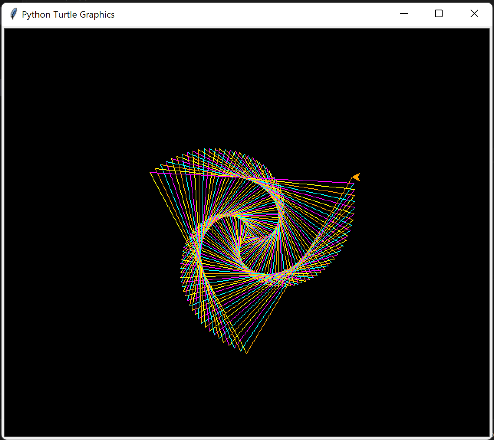

# 🐢 Ateliers de Découverte : Créer avec Python Turtle

Ce dépôt présente mon travail pratique et ma réalisation artistique basée sur l'exercice 2 du module graphique **Turtle** de Python. L'objectif est d'explorer l'utilisation des boucles et la variation progressive des paramètres géométriques.

---

## 📂 Contenu de la Réalisation

### La Spirale Géométrique (Exercice 2)

- **Description du dessin :**
  Ce motif artistique multicolore est généré par une boucle itérative qui fait progresser la distance de déplacement de la tortue à chaque étape. En associant cette variation numérique à un changement cyclique de couleurs (cyan, magenta, jaune, orange) et un angle de rotation précis, la figure se déploie progressivement pour former une spirale géométrique hypnotique.

- **Rendu visuel :**
  > 

---

## 🚀 Comment exécuter le script ?

1. Assurez-vous d'avoir Python installé sur votre machine.
2. Clonez ce dépôt ou téléchargez les fichiers du projet.
3. Lancez le script depuis votre terminal :
   ```bash
   python exp2.py
   ```
